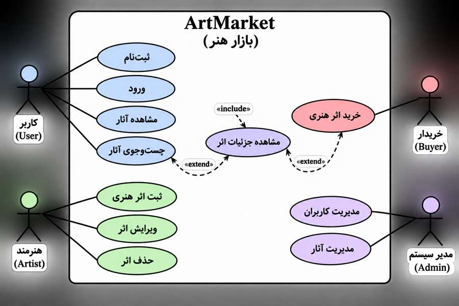

# مستندات پروژه ArtMarket (بازار هنر)

## ۱. معرفی پروژه (Project Introduction)

ArtMarket یک بازار آنلاین برای نمایش، معرفی و خرید و فروش آثار هنری است که با هدف ایجاد ارتباط میان هنرمندان و علاقه‌مندان به هنر طراحی شده است.

## ۲. اهداف پروژه (Project Goals)

- ایجاد بازار آنلاین برای خرید و فروش آثار هنری
- معرفی و نمایش آثار هنرمندان
- ایجاد ارتباط مستقیم میان هنرمندان و خریداران
- تسهیل جست‌وجو و خرید آثار هنری
- حمایت از هنرمندان و افزایش دیده‌شدن آثار آن‌ها

## ۳. امکانات پروژه (Project Features)

- ثبت‌نام و ورود کاربران
- ایجاد و مدیریت حساب کاربری
- ثبت آثار هنری توسط هنرمندان
- نمایش آثار هنری همراه با تصویر، توضیحات و قیمت
- جست‌وجو و دسته‌بندی آثار
- مشاهده جزئیات آثار هنری
- امکان خرید آثار
- ویرایش و حذف آثار توسط هنرمندان

## ۴. کاربران هدف (Target Users)

- هنرمندان و نقاشان
- علاقه‌مندان به هنر
- خریداران آثار هنری
- مجموعه‌داران آثار هنری

## ۵. محدودیت‌ها و چالش‌ها (Constraints)

- محدودیت زمان برای طراحی و پیاده‌سازی
- نیاز به دانش برنامه‌نویسی
- محدودیت منابع و امکانات
- حفظ امنیت اطلاعات کاربران
- مدیریت اطلاعات آثار هنری
- امکان توسعه پروژه در آینده

## ۶. پرسوناها (Personas)

### پرسونا اول: هنرمند

- نام: نگار
- سن: ۲۸ سال
- شغل: نقاش و هنرمند مستقل
- هدف: فروش و معرفی آثار هنری
- نیاز: بستری برای نمایش و فروش آثار
- مشکل: دشواری در پیدا کردن مشتری

### پرسونا دوم: خریدار

- نام: علی
- سن: ۳۲ سال
- شغل: کارمند
- هدف: خرید آثار هنری
- نیاز: دسترسی آسان به آثار متنوع
- مشکل: دشواری در پیدا کردن اثر مناسب

### پرسونا سوم: علاقه‌مند به هنر

- نام: سارا
- سن: ۲۴ سال
- شغل: دانشجو
- هدف: آشنایی با آثار و هنرمندان
- نیاز: مشاهده و جست‌وجوی آثار
- مشکل: دسترسی محدود به نمایشگاه‌های هنری

## ۷. نیازمندی‌های پروژه (Requirements)

### نیازمندی‌های عملکردی (Functional Requirements)

- امکان ثبت‌نام کاربران
- امکان ورود و خروج
- ثبت آثار هنری توسط هنرمندان
- مشاهده و جست‌وجوی آثار
- نمایش جزئیات آثار
- ویرایش و حذف آثار
- خرید آثار هنری

### نیازمندی‌های غیرعملکردی (Non-Functional Requirements)

- طراحی ساده و کاربرپسند
- امنیت اطلاعات کاربران
- سرعت مناسب بارگذاری صفحات
- قابلیت توسعه در آینده
- سازگاری با مرورگرهای رایج
- 
# ۸. موارد کاربرد (Use Case)

## تعریف Use Case

Use Case یا مورد کاربرد، روشی برای نمایش تعامل کاربران با یک سیستم است. این نمودار مشخص می‌کند کاربران چه فعالیت‌هایی می‌توانند در سیستم انجام دهند و سیستم چگونه به درخواست‌های آن‌ها پاسخ می‌دهد.

## هدف Use Case در پروژه ArtMarket

هدف از طراحی Use Case در پروژه ArtMarket، مشخص کردن ارتباط میان کاربران و امکانات سایت است. با استفاده از آن می‌توان فعالیت‌های هنرمندان، خریداران و مدیر سیستم را شناسایی و بررسی کرد.

## بازیگران سیستم (Actors)

| بازیگر | توضیحات |
|---|---|
| کاربر (User) | فردی که از امکانات عمومی سایت استفاده می‌کند. |
| هنرمند (Artist) | فردی که آثار هنری خود را ثبت و مدیریت می‌کند. |
| خریدار (Buyer) | فردی که آثار هنری را مشاهده و خریداری می‌کند. |
| مدیر سیستم (Admin) | فردی که کاربران و آثار هنری را مدیریت می‌کند. |

## کاربرد Use Case

با استفاده از این مدل، امکانات سیستم مشخص می‌شوند و روند ارتباط کاربران با سایت قابل بررسی خواهد بود.
- 

## ۹. سناریوهای موارد کاربرد (Use Case Scenarios)

## ۱۰. نمودار UML موارد کاربرد (Use Case Diagram)

## ۱۱. سناریوهای موارد کاربرد (Use Case Scenarios)

### سناریوی ۱: ثبت‌نام کاربر (Register)

| عنوان | شرح |
|---|---|
| نام مورد کاربرد | ثبت‌نام کاربر |
| بازیگر اصلی | کاربر (User) |
| هدف | ایجاد حساب کاربری جدید در ArtMarket |
| پیش‌شرط | کاربر حساب کاربری نداشته باشد |
| پس‌شرط | حساب کاربری با موفقیت ایجاد شده باشد |

**سناریوی اصلی:**

۱. کاربر وارد صفحه ثبت‌نام می‌شود.
۲. سیستم فرم ثبت‌نام را نمایش می‌دهد.
۳. کاربر اطلاعات موردنیاز را وارد می‌کند.
۴. کاربر دکمه ثبت‌نام را انتخاب می‌کند.
۵. سیستم اطلاعات واردشده را بررسی می‌کند.
۶. سیستم حساب کاربری جدید ایجاد می‌کند.
۷. پیام موفقیت ثبت‌نام به کاربر نمایش داده می‌شود.

**سناریوی جایگزین:**

- اگر اطلاعات واردشده ناقص باشد، سیستم پیام خطا نمایش می‌دهد.
- اگر اطلاعات کاربر قبلاً ثبت شده باشد، سیستم پیام تکراری بودن حساب را نمایش می‌دهد.

### سناریوی ۲: ورود به سیستم (Login)

| عنوان | شرح |
|---|---|
| نام مورد کاربرد | ورود به سیستم |
| بازیگر اصلی | کاربر (User) |
| هدف | ورود به حساب کاربری |
| پیش‌شرط | کاربر قبلاً ثبت‌نام کرده باشد |
| پس‌شرط | کاربر با موفقیت وارد سیستم شود |

**سناریوی اصلی:**

۱. کاربر وارد صفحه ورود می‌شود.
۲. سیستم فرم ورود را نمایش می‌دهد.
۳. کاربر نام کاربری و رمز عبور را وارد می‌کند.
۴. کاربر دکمه ورود را انتخاب می‌کند.
۵. سیستم اطلاعات ورود را بررسی می‌کند.
۶. در صورت صحیح بودن اطلاعات، سیستم کاربر را وارد حساب می‌کند.
۷. صفحه اصلی حساب کاربری نمایش داده می‌شود.

**سناریوی جایگزین:**

- اگر نام کاربری یا رمز عبور اشتباه باشد، سیستم پیام خطا نمایش می‌دهد.
- اگر فیلدها خالی باشند، سیستم از کاربر می‌خواهد اطلاعات را تکمیل کند.

### سناریوی ۳: مشاهده آثار هنری (View Artworks)

| عنوان | شرح |
|---|---|
| نام مورد کاربرد | مشاهده آثار هنری |
| بازیگر اصلی | کاربر (User) |
| هدف | مشاهده آثار هنری موجود در بازار |
| پیش‌شرط | آثار هنری در سیستم ثبت شده باشند |
| پس‌شرط | آثار هنری به کاربر نمایش داده شوند |

**سناریوی اصلی:**

۱. کاربر وارد صفحه اصلی سایت می‌شود.
۲. سیستم فهرست آثار هنری را نمایش می‌دهد.
۳. کاربر آثار مختلف را مشاهده می‌کند.
۴. کاربر یک اثر هنری را انتخاب می‌کند.
۵. سیستم تصویر و اطلاعات اثر را نمایش می‌دهد.
۶. کاربر جزئیات اثر را مشاهده می‌کند.

**سناریوی جایگزین:**

- اگر هیچ اثری ثبت نشده باشد، سیستم پیام «هنوز اثری ثبت نشده است» نمایش می‌دهد.
- اگر اطلاعات یک اثر در دسترس نباشد، سیستم پیام مناسب نمایش می‌دهد.
### سناریوی ۴: جست‌وجوی آثار هنری (Search Artworks)

| عنوان | شرح |
|---|---|
| نام مورد کاربرد | جست‌وجوی آثار هنری |
| بازیگر اصلی | کاربر (User) |
| هدف | پیدا کردن اثر هنری موردنظر |
| پیش‌شرط | آثار هنری در سیستم ثبت شده باشند |
| پس‌شرط | نتایج مرتبط به کاربر نمایش داده شوند |

**سناریوی اصلی:**

۱. کاربر وارد صفحه جست‌وجو می‌شود.
۲. سیستم کادر جست‌وجو را نمایش می‌دهد.
۳. کاربر نام اثر یا دسته‌بندی موردنظر را وارد می‌کند.
۴. کاربر دکمه جست‌وجو را انتخاب می‌کند.
۵. سیستم اطلاعات آثار را بررسی می‌کند.
۶. سیستم آثار مرتبط را نمایش می‌دهد.
۷. کاربر اثر موردنظر را انتخاب می‌کند.

**سناریوی جایگزین:**

- اگر اثری مطابق عبارت جست‌وجو وجود نداشته باشد، پیام «موردی یافت نشد» نمایش داده می‌شود.
- اگر کادر جست‌وجو خالی باشد، سیستم از کاربر می‌خواهد عبارت موردنظر را وارد کند.
### سناریوی ۵: ثبت اثر هنری (Add Artwork)

| عنوان | توضیحات |
|---|---|
| نام مورد کاربرد | ثبت اثر هنری |
| بازیگر اصلی | هنرمند (Artist) |
| هدف | اضافه کردن یک اثر هنری جدید به بازار هنر |
| پیش‌شرط | هنرمند وارد حساب کاربری خود شده باشد |
| پس‌شرط | اثر هنری در سیستم ذخیره و نمایش داده شود |

**جریان اصلی:**

۱. هنرمند وارد حساب کاربری خود می‌شود.

۲. بخش «ثبت اثر هنری» را انتخاب می‌کند.

۳. سیستم فرم ثبت اثر را نمایش می‌دهد.

۴. هنرمند نام اثر، تصویر، توضیحات و قیمت آن را وارد می‌کند.

۵. هنرمند دکمه «ثبت اثر» را انتخاب می‌کند.

۶. سیستم اطلاعات واردشده را بررسی می‌کند.

۷. سیستم اثر هنری را ذخیره می‌کند.

۸. اثر جدید در فهرست آثار هنری نمایش داده می‌شود.

**جریان جایگزین:**

- اگر اطلاعات ضروری وارد نشده باشد، سیستم پیام خطا نمایش می‌دهد.
- اگر اطلاعات واردشده معتبر نباشد، سیستم از هنرمند می‌خواهد آن‌ها را اصلاح کند.
### سناریوی ۶: خرید اثر هنری (Purchase Artwork)

| عنوان | توضیحات |
|---|---|
| نام مورد کاربرد | خرید اثر هنری |
| بازیگر اصلی | خریدار (Buyer) |
| هدف | خرید یک اثر هنری موردنظر |
| پیش‌شرط | خریدار وارد حساب کاربری شده و اثر هنری موجود باشد |
| پس‌شرط | سفارش خرید در سیستم ثبت شود |

**جریان اصلی:**

۱. خریدار وارد حساب کاربری خود می‌شود.

۲. فهرست آثار هنری را مشاهده می‌کند.

۳. اثر هنری موردنظر را انتخاب می‌کند.

۴. سیستم اطلاعات و قیمت اثر را نمایش می‌دهد.

۵. خریدار گزینه «خرید اثر» را انتخاب می‌کند.

۶. سیستم اطلاعات سفارش را بررسی می‌کند.

۷. خریدار خرید خود را تأیید می‌کند.

۸. سیستم سفارش را ثبت کرده و پیام موفقیت نمایش می‌دهد.

**جریان جایگزین:**

- اگر اثر هنری موجود نباشد، سیستم پیام مناسب نمایش می‌دهد.
- اگر اطلاعات سفارش ناقص باشد، سیستم از خریدار می‌خواهد آن را تکمیل کند.

  
### سناریوی ۷: مدیریت آثار هنری (Manage Artworks)

| عنوان | توضیحات |
|---|---|
| نام مورد کاربرد | مدیریت آثار هنری |
| بازیگر اصلی | مدیر سیستم (Admin) |
| هدف | بررسی، ویرایش یا حذف آثار هنری |
| پیش‌شرط | مدیر وارد حساب کاربری خود شده باشد |
| پس‌شرط | تغییرات موردنظر در سیستم ذخیره شوند |

**جریان اصلی:**

۱. مدیر وارد حساب کاربری خود می‌شود.

۲. بخش مدیریت آثار هنری را انتخاب می‌کند.

۳. سیستم فهرست آثار ثبت‌شده را نمایش می‌دهد.

۴. مدیر اثر موردنظر را انتخاب می‌کند.

۵. مدیر یکی از گزینه‌های ویرایش یا حذف را انتخاب می‌کند.

۶. سیستم درخواست مدیر را بررسی می‌کند.

۷. سیستم تغییرات را ذخیره می‌کند.

۸. پیام موفقیت به مدیر نمایش داده می‌شود.

**جریان جایگزین:**

- اگر اثری برای مدیریت وجود نداشته باشد، سیستم پیام «اثری ثبت نشده است» نمایش می‌دهد.
- اگر اطلاعات ویرایش‌شده معتبر نباشد، سیستم پیام خطا نمایش می‌دهد.

### سناریوی ۸: خروج از حساب کاربری (Logout)

| عنوان | توضیحات |
|---|---|
| نام مورد کاربرد | خروج از حساب کاربری |
| بازیگر اصلی | کاربر (User) |
| هدف | خارج شدن از حساب کاربری |
| پیش‌شرط | کاربر وارد حساب کاربری شده باشد |
| پس‌شرط | کاربر از حساب خود خارج شده باشد |

**جریان اصلی:**

۱. کاربر وارد حساب کاربری خود می‌شود.

۲. گزینه «خروج از حساب» را انتخاب می‌کند.

۳. سیستم درخواست خروج را دریافت می‌کند.

۴. سیستم نشست کاربر را پایان می‌دهد.

۵. پیام خروج موفقیت‌آمیز نمایش داده می‌شود.

۶. کاربر به صفحه اصلی منتقل می‌شود.

**جریان جایگزین:**

- اگر کاربر از قبل وارد حساب نشده باشد، گزینه خروج برای او نمایش داده نمی‌شود.
- اگر خروج با مشکل مواجه شود، سیستم پیام خطا نمایش می‌دهد.

## ۱۱. جمع‌بندی و نتیجه‌گیری

پروژه ArtMarket با هدف ایجاد یک بازار آنلاین برای هنرمندان و علاقه‌مندان به هنر طراحی شده است. این سامانه به هنرمندان کمک می‌کند آثار خود را معرفی و ثبت کنند و به خریداران امکان می‌دهد آثار هنری موردنظر خود را مشاهده، جست‌وجو و خریداری کنند.

در این پروژه تلاش شده است با طراحی امکاناتی مانند ثبت‌نام، ورود به حساب کاربری، ثبت آثار هنری، جست‌وجو و خرید آثار، بستری مناسب برای ارتباط میان هنرمندان و خریداران فراهم شود.

ArtMarket می‌تواند در آینده با افزودن امکانات بیشتر، به یک بازار آنلاین کامل‌تر برای عرضه و معرفی آثار هنری تبدیل شود.
